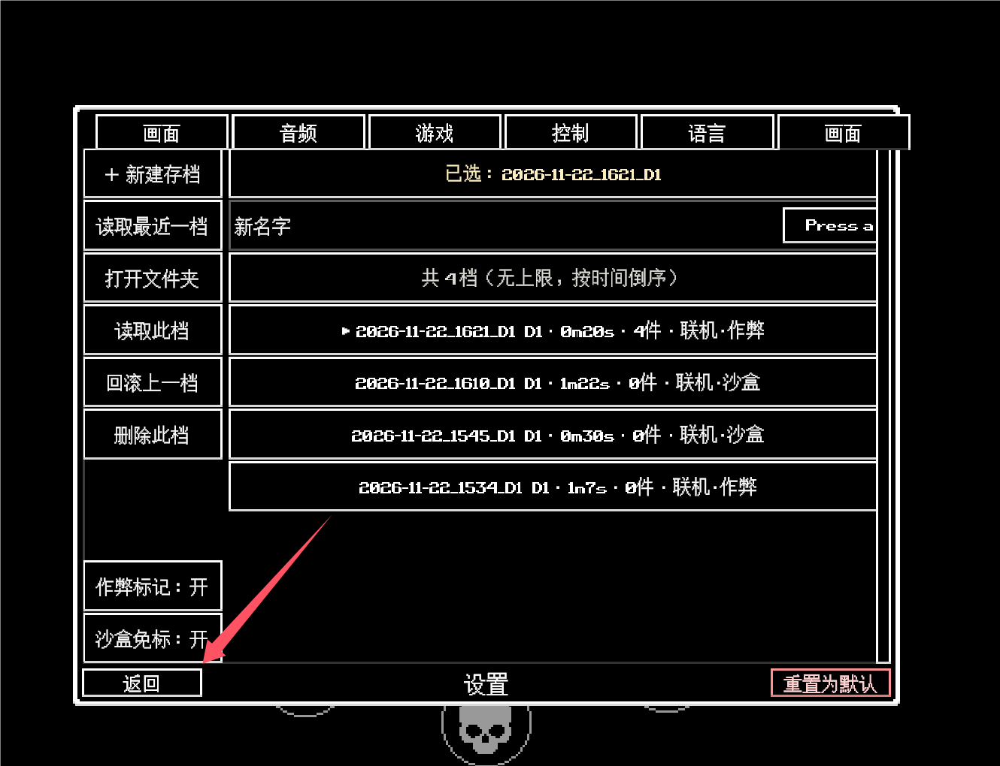

# Casualties Save Slots

给 **Casualties Unknown** 加**无上限存档槽**的 BepInEx 5 插件喵。
Unlimited save slots for **Casualties Unknown** (BepInEx 5 plugin).

原版只有一个续关点 `save.sv`，而且**读档成功后就把文件删掉**；这个插件把每次存档拍成独立快照，随时存、随时挑一档读，游戏外也能直接拖文件换档。



## 功能

- **无上限存档槽**：每次存档一个独立文件夹，自动命名（`2026-11-22_1534_D1`）
- **游戏内随时存档**：热键 `F5`，不用回主菜单
- **设置菜单里的「存档」分页**：第 6 个分页，界面全部用游戏原生 prefab 拼，字体/边框/高亮/音效与其它设置页一致
- **游戏内直接读档**：自动「解除暂停 → 回主菜单 → 铺档 → 继续」，回到该层的开头
- **沙盒 / 实机存档双向隔离**：沙盒里只看得到沙盒档，实机里只看得到实机档，跨模式读取会被拒绝
- **联机兼容**：[CasualtiesTogether](https://github.com/creaturefeaturelarry/casualties-together) 的 `mp_save\`（含每个玩家的 `STEAM_<id>\save.sv`、`mp_rules.json`）整目录收进槽里
- **覆盖前自动留上一档**，随时回滚
- **所有开关都能在游戏里改**（存档页左栏 →「存档选项与设置 ▸」独立子页），改完立刻写盘
- **控制台命令**，方便脚本化

## 安装

需要 **BepInEx 5.4.23.x**（`netstandard2.1`）。

**Gale**：放进 profile 的插件目录

```
%APPDATA%\com.kesomannen.gale\casualties-unknown\profiles\<profile>\BepInEx\plugins\CSSaveSlots\CSSaveSlots.dll
```

**手动装 BepInEx**：

```
<游戏目录>\BepInEx\plugins\CSSaveSlots\CSSaveSlots.dll
```

启动游戏后 `BepInEx\LogOutput.log` 里应能看到 `设置页已注册「存档」分页`。

## 使用

| 键 | 作用 |
|---|---|
| `F5` | 存档到新槽（自动命名） |
| `F8` | 打开设置 →「存档」分页（游戏内会先自动暂停） |
| `F9` | 读最近一档（按当前模式取） |

也可以走原生路径：`Esc` 暂停 → 设置 → 点「存档」分页。

### 存档页

```
┌──────────────┬──────────────────────────────────────────┐
│ ＋ 新建存档   │ 已选：2026-11-22_1534_D1                 │
│ 读取最近一档  │ ┌ 新名字 ──────────────────────────────┐ │
│ 打开文件夹    │ └──────────────────────────────────────┘ │
│ 读取此档      │ 共 4 档（无上限，按时间倒序）             │
│ 回滚上一档    │ ▶ 2026-11-22_1621_D1  D1 · 0m28s · 4件 · 联机 │
│ 删除此档      │   2026-11-22_1610_D1  D1 · 1m22s · 0件 · 沙盒 │
│ 存档设置 ▸    │   …（右侧列表可滚轮/拖拽滚动）            │
└──────────────┴──────────────────────────────────────────┘
```

「存档设置 ▸」进入独立子页：游戏内读档 / 自动存档 / 自动间隔 / 标记作弊 / 沙盒不标作弊 / 联机允许 / 覆盖前保留 / 绕过教程门禁。

### 控制台命令

```
cssave [名字]      存一个新槽（不写名字=自动命名）
cslots             列出所有槽
csload <槽名>      读这个槽（回主菜单流程）
csslots            打开设置里的「存档」分页
csdir              打开存档目录
csdel <槽名>       删除
csrename <旧> <新>  改名
csrollback <槽名>   回滚到该槽的 backup/
csexport <槽名>     把槽铺成游戏当前的 save.sv
```

## 存档放在哪

```
%USERPROFILE%\AppData\LocalLow\Orsoniks\CasualtiesUnknown\SaveSlots\
  <槽名>\
    meta.json     元数据（时间/层数/存活/角色/件数/模式/沙盒/作弊/玩家）
    save.sv       单人存档（原版格式，gzip + JSON）
    mp\           联机存档（存在时才有）
    backup\       覆盖同名槽之前的上一档
```

### 不进游戏换档

1. 关掉游戏；
2. 把 `SaveSlots\<槽名>\save.sv` 覆盖到 `...\Orsoniks\CasualtiesUnknown\save.sv`；
3. 联机档就把 `SaveSlots\<槽名>\mp\` 整个覆盖到 `...\CasualtiesUnknown\mp_save\`；
4. 开游戏 → 主菜单点「继续」。

## 配置

`BepInEx\config\xiaomi.cssaveslots.cfg`（也能在游戏里的「存档设置」子页改，重启后保持）

| 键 | 默认 | 说明 |
|---|---|---|
| `ExperimentalInGameLoad` | `true` | 游戏内直接读档 |
| `AutoSave.Enabled` / `Minutes` | `false` / `5` | 定时自动存档 |
| `MarkCheatedSave` | `false` | 存档标记 cheated（成就关闭到重启） |
| `SandboxNoCheatMark` | `true` | 沙盒里不标作弊 |
| `AllowInMultiplayer` | `true` | 联机时允许存读档 |
| `KeepLastBackup` | `true` | 覆盖同名槽前保留上一档 |
| `BypassTutorialGate` | `true` | 没做完基础教程也能读档 |
| `SlotRootOverride` | 空 | 自定义存档根目录 |
| `QuickSave` / `QuickLoad` / `Panel` | `F5` / `F9` / `F8` | 键位 |

## 构建

```powershell
git clone https://github.com/SuzuAy/Casualties-Save-Slots
cd Casualties-Save-Slots
Copy-Item local.props.example local.props   # 填自己的游戏路径
dotnet build CSSaveSlots.csproj -c Release
```

`local.props` 填两个路径：

- `GameRoot`：游戏根目录（含 `CasualtiesUnknown_Data\Managed`）
- `GaleProfileBepInEx`：Gale 的 BepInEx 目录（含 `core\`、`plugins\`），手动装 BepInEx 时也填那里

编完会自动把 DLL 拷到 `$(GaleProfileBepInEx)\plugins\CSSaveSlots\`（游戏开着锁文件只警告、不中断编译）。

也可以直接命令行覆盖：

```powershell
dotnet build -c Release -p:GameRoot="D:\Games\Casualties Unknown" -p:GaleProfileBepInEx="D:\Games\Casualties Unknown\BepInEx"
```

## 已知限制

1. **读档回到当前层的开头**：原版 `save.sv` 只存身体/物品/世界数值，不含地图布局与玩家坐标，地图每层随机重新生成（原版 `saveandquit` 同样如此）。
2. **深度 ≥ 9（WHERE WE MUST REACH 及之后）**：原版不许存档，本插件绕过控制台检查直接调 `SaveGame()`，但读回来是否正常未验证，建议别在终点层存。
3. **联机**：只负责整目录搬运 `mp_save\`，多人局细节取决于 CasualtiesTogether 本身。
4. **成就**：`MarkCheatedSave` 默认关；打开后按原版语义「成就关闭到重启」。

## 兼容性

| 项 | 版本 |
|---|---|
| 游戏 | Casualties Unknown（Unity **2022.3.62f3**，Mono） |
| BepInEx | 5.4.23.x（`netstandard2.1`） |
| HarmonyX | 随 BepInEx 一起（`0Harmony.dll`） |
| 联机模组 | CasualtiesTogether（`mp_save\` 格式） |

## 许可

MIT。与游戏开发商无关，使用风险自负，请先备份存档。
